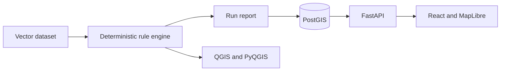

# Architecture

## Boundaries

- **Rule engine:** validates known conditions such as geometry validity, empty geometry, duplicate identifiers, CRS metadata, and project-specific spatial rules. It must return structured findings and make no unverified repair.
- **Storage:** keeps datasets, validation runs, and findings. Browser-ready geometry is transformed to EPSG:4326 only when the source CRS is known.
- **API:** provides bounded, read-only access to findings. It validates query limits and BBOX values before querying PostGIS.
- **Web:** visualises findings and explains their severity. It never receives database credentials.
- **QGIS:** supports local inspection and repeatable Processing workflows. It must avoid absolute user paths.

An optional AI layer may explain an already verified finding. It does not choose a CRS, decide validity, modify source data, or create findings without a deterministic source rule.
